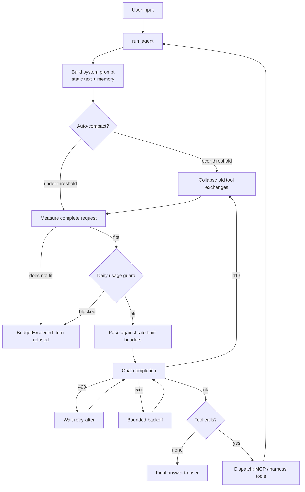

# Architecture

The harness is a local, single-process coding agent. One Python process runs the
REPL, the agent loop and the MCP client; a child process runs the MCP tool
server. There is no external orchestration: a turn is a loop of chat completions
and tool calls against one OpenAI-compatible endpoint.

## Main components

| Module | Responsibility |
|---|---|
| `src/main.py` | CLI entry point, REPL, slash commands, session persistence calls |
| `src/agent.py` | The agentic loop: system prompt, request lifecycle, retries, tool-call parsing and dispatch |
| `src/llm_client.py` | OpenAI-compatible client factory (`max_retries=0`) and `GET /models` discovery |
| `src/providers.py` | Provider registry: turns a provider name into base URL + API key + model |
| `src/models.py` | Per-provider model state, bundled limits, and the per-request budget |
| `src/budget.py` | Request measurement, history compaction, automatic compaction |
| `src/tokenization.py` | Model-aware token estimation and tokenizer calibration |
| `src/usage.py` | Daily per-provider/model usage counters and the projected request guard |
| `src/usage_report.py` | Normalises provider-reported token usage into one `TokenUsage` value |
| `src/mcp_client.py` | Stdio MCP bridge: spawns the server, exposes tools, truncates output |
| `src/environment.py` | `python_environment_info` diagnostic and approval-gated `install_package` |
| `src/approval.py` | The yes/no gate used by package installation |
| `src/memory.py` | Capped, atomic writer for `workspace/memory.md` |
| `src/session.py` | Load/save/clear of `.agent/session.json` |
| `src/config.py` | Paths, `.env` loading, every tunable (read once at startup) |

## Execution flow

1. **Startup** — `main.py` parses CLI flags, disables session persistence for
   `--no-session`, refuses a global interpreter, resolves the provider
   (`--provider` or `LLM_PROVIDER`), optionally switches the model, loads
   `.agent/session.json` and prints the connection/budget summary.
2. **User turn** — the REPL calls `run_agent(prompt, messages, provider)`.
3. **Prompt assembly** — the new user message is appended to the history and the
   system prompt is built: a short static block plus the memory file
   (`workspace/memory.md`), capped and placed after the static text so the
   cacheable prefix stays byte-identical across iterations. The server's Python
   session is reset so state cannot leak between turns.
4. **Request preparation** (`src/budget.py`, `src/models.py`) — the complete
   request (system prompt + tool schemas + history) is measured with a
   model-aware tokenizer. Automatic compaction runs first if the measured request
   is over the configured threshold; otherwise history is collapsed just enough
   (`build_payload`) to fit the model's input budget. A request that still does
   not fit is refused before it is sent (`BudgetExceeded`).
5. **Daily guard** (`src/usage.py`) — before the request is sent, the projected
   size (estimated input + reserved output) is checked against today's RPD/TPD
   counters where bundled limits exist. A projected violation is refused with the
   reset time instead of waiting out a 429.
6. **Provider call** (`src/agent.py`) — pacing waits when the provider's
   `x-ratelimit-remaining-tokens` header says the window cannot cover the
   request, then the completion is sent. 413 compacts once and retries, 429 waits
   for the provider's `retry-after`, 5xx backs off with jitter, and a 400 about
   `max_tokens` switches to `max_completion_tokens`. Usage is recorded
   (reported first, estimate only as a fallback) and the chars/token calibration
   is updated.
7. **Response handling** — native `tool_calls` are executed; otherwise two text
   protocols are parsed as a fallback (a bare JSON object, and the MiniMax
   XML-ish serialization with its token noise). Arguments are validated against
   the advertised schema, path arguments are normalised and checked, and results
   are appended as `role:"tool"` messages.
8. **Tool execution** — MCP tools go through the stdio bridge
   (`src/mcp_client.py`); `save_memory` and `python_environment_info` are handled
   in-process by the harness; `install_package` is intercepted and routed through
   the approval gate. Duplicate calls re-execute by default (opt-in dedup) and a
   per-turn execution cap bounds how many run.
9. **Loop and answer** — the loop repeats until the model returns text with no
   tool calls, or the final iteration is reached. The last iteration runs
   without tools and with an appended note telling the model to summarise.
   Truncated answers get a visible marker; a truncated tool call is never
   executed and the turn fails loudly (`AgentError`) rather than saving a fake
   answer as history.

## How state is stored

| File | Contents | Owner |
|---|---|---|
| `.agent/session.json` | Conversation history | `src/session.py` |
| `.agent/models.json` | Active model per provider | `src/models.py` |
| `.agent/usage.json` | Today's request/token counters per `provider:model` | `src/usage.py` |
| `.agent/tokenizer.json` | Learned chars-per-token ratios per model | `src/tokenization.py` |
| `.agent/memory.bak` | Last good memory, written before every save | `src/memory.py` |
| `workspace/memory.md` | Persistent agent memory (also read by the agent's tools) | `src/memory.py` |

All state files are written atomically (temp file + `os.replace`), and every
best-effort writer treats a read-only or missing `.agent/` directory as
non-fatal.

## Key design boundaries

- **Estimates vs. reported usage.** Local token counts always carry provenance
  (`exact` / approximate) and are never written to history or accounting as if
  the provider had reported them. Reported usage is preferred everywhere it
  exists.
- **Request budget vs. daily allowance.** `src/budget.py` decides whether a
  request *may be sent* (size); `src/usage.py` decides whether the *account* can
  absorb it (rate limits). A local budget never overrides a provider limit.
- **Harness state vs. agent files.** Memory lives in the workspace so the agent
  can read it, but the harness is the writer (`save_memory` is in-process).
  Conversation history lives outside the workspace so the agent cannot rewrite
  it.
- **One environment.** The harness interpreter, the MCP server executable, the
  interpreter used by the Python tools, the pip target and the package query are
  all the same virtual environment; a global interpreter is refused.
